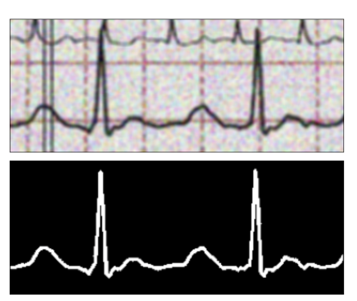
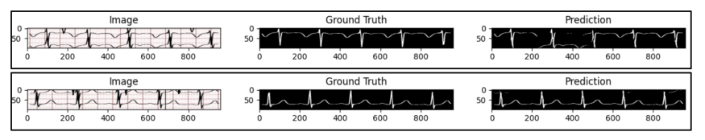
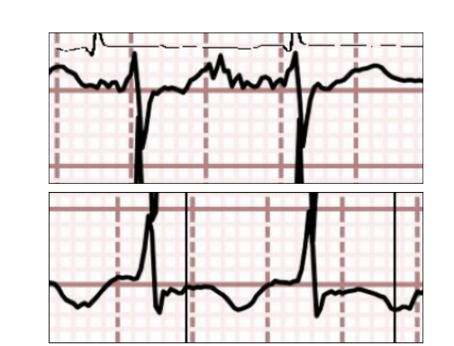
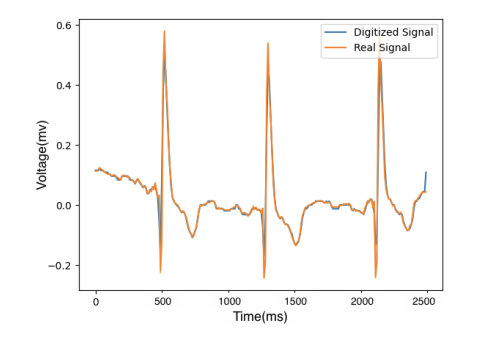
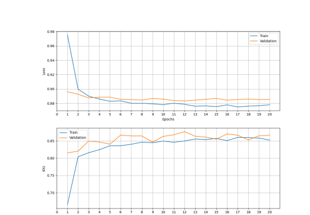

# Deep Learning-Based Digitization of Overlapping ECG Images

[Paper (arXiv)](https://arxiv.org/abs/2506.10617) · [PDF](https://arxiv.org/pdf/2506.10617)

Paper-based electrocardiogram (ECG) records remain common in clinical archives, but converting them into analyzable time-series data is difficult—especially when adjacent leads **overlap** on the page, a case where existing digitization methods often degrade sharply. This repository implements a **two-stage pipeline**: a U-Net segmentation network (trained on overlap-rich data with custom augmentations) isolates the primary ECG trace, then an adaptive grid-detection module and established digitization techniques convert the binary mask into a calibrated time-series signal. The U-Net reaches an **IoU of 0.87**. On non-overlapping samples we obtain **MSE 0.0010** and **ρ 0.9644** (baseline: 0.0015 / 0.9366); on overlapping samples **MSE 0.0029** and **ρ 0.9641**, substantially better than the baseline (**0.0178** / **0.8676**).

| Setting | Method | MSE ↓ | ρ ↑ |
|---|---|---:|---:|
| No overlap (N=185) | Proposed | **0.0010** | **0.9644** |
| No overlap (N=185) | Baseline | 0.0015 | 0.9366 |
| With overlap (N=100) | Proposed | **0.0029** | **0.9641** |
| With overlap (N=100) | Baseline | 0.0178 | 0.8676 |

---

## Citation

If you use this code, the method, or the related dataset, please cite:

| Resource | Link |
|---|---|
| Method paper of this code | [arXiv:2506.10617](https://arxiv.org/abs/2506.10617) |
| This code | [github.com/masoudrahimi39/ECG-code](https://github.com/masoudrahimi39/ECG-code) |
| Dataset paper used by this code (two versions) | [PMC (JMSS 2026)](https://pmc.ncbi.nlm.nih.gov/articles/PMC13152245/) and [arXiv:2506.06315](https://arxiv.org/abs/2506.06315) |
| Dataset code | [github.com/rezakarbasi/ecg-image-and-signal-dataset](https://github.com/rezakarbasi/ecg-image-and-signal-dataset) |
| Dataset (Zenodo) | [doi:10.5281/zenodo.15484519](https://zenodo.org/records/15484519) |

```bibtex
@article{karbasi2025digitization,
  title   = {Deep Learning-Based Digitization of Overlapping {ECG} Images with Open-Source Python Code},
  author  = {Karbasi, Reza and Rahimi, Masoud and Vahabie, Abdol-Hossein and Moradi, Hadi},
  journal = {arXiv preprint arXiv:2506.10617},
  year    = {2025},
  url     = {https://arxiv.org/abs/2506.10617}
}

@article{rahimi2025ecgdataset,
  title   = {An Open-Source Python Framework and Synthetic {ECG} Image Datasets for Digitization, Lead and Lead Name Detection, and Overlapping Signal Segmentation},
  author  = {Rahimi, Masoud and Karbasi, Reza and Vahabie, Abdol-Hossein},
  journal = {Journal of Medical Signals \& Sensors},
  volume  = {16},
  number  = {3},
  pages   = {8},
  year    = {2026},
  doi     = {10.4103/jmss.jmss_58_25},
  url     = {https://arxiv.org/abs/2506.06315}
}
```

---

## Features

This repository provides the open-source implementation of the digitization pipeline from the paper above.

### Overlap-robust U-Net segmentation

A ResNet34-backed U-Net isolates the primary lead waveform from the paper grid, noise, and **overlapping** adjacent traces, producing a clean binary mask for digitization.

<p align="center">
  
  <br/>
  <em>Fig. 1. Example of an input ECG lead image (upper) and the corresponding predicted segmentation mask (bottom) from the U-Net model.</em>
</p>

<p align="center">
  
  <br/>
  <em>Fig. 2. Qualitative results of the U-Net segmentation model on samples with overlapping signals. Left: input; middle: ground truth; right: prediction.</em>
</p>

Training scripts and inference live under [`model/segmentation/unet/`](model/segmentation/unet/). End-to-end segmentation → digitization evaluation is driven by [`model/inference.py`](model/inference.py).

### Custom data augmentations

Training is fortified with augmentations tailored to paper-ECG artifacts, including **OverlaySignal** (simulated lead overlap) and **AddVerticalLines** (pen marks / folds / scan artifacts).

<p align="center">
  
  <br/>
  <em>Fig. 3. Example of the augmentations. Upper: OverlaySignal; bottom: AddVerticalLines.</em>
</p>

### Adaptive grid detection and digitization

After segmentation, [`model/grid_detection.py`](model/grid_detection.py) estimates grid spacing so scales adapt across formats and resolutions. The mask is then converted to a time series using techniques built on the vendored [`ecg-digitize`](model/digitization/ecg-digitize/) toolkit.

<p align="center">
  
  <br/>
  <em>Fig. 4. Digitized ECG signal (blue) compared against the ground-truth signal (orange/red).</em>
</p>

### Training curves and evaluation helpers

U-Net training reaches strong validation IoU within ~20 epochs (see Fig. 5). Correlation / alignment helpers for comparing digitized vs. ground-truth signals are in [`example/compare.py`](example/compare.py).

<p align="center">
  
  <br/>
  <em>Fig. 5. Training and validation loss (top) and IoU (bottom) for the U-Net segmentation model.</em>
</p>

### Related modules

- **Dataset generation / prep:** [`prepare_image_dataset/`](prepare_image_dataset/) (local helpers); full synthetic dataset framework: [ecg-image-and-signal-dataset](https://github.com/rezakarbasi/ecg-image-and-signal-dataset)
- **Lead detection (YOLO):** [`model/detection/`](model/detection/) and [`model/segmentation/yolo/`](model/segmentation/yolo/) for lead-region / related experiments

---

## Installation

- Python **> 3.11**
- Install dependencies:

```bash
pip install -r requirements.txt
```

### Data

Download the companion datasets from [Zenodo](https://zenodo.org/records/15484519), or generate your own with the [dataset framework](https://github.com/rezakarbasi/ecg-image-and-signal-dataset). See the [dataset paper](https://arxiv.org/abs/2506.06315) for details on segmentation and overlap splits.

### Model weights

Checkpoints (`*.ckpt`, `*.pt`) are **not** shipped in this repository (they are gitignored). Train a U-Net with [`model/segmentation/unet/train.py`](model/segmentation/unet/train.py), or place your own weights and point inference scripts (e.g. [`model/inference.py`](model/inference.py)) at them.

---

## Acknowledgments

Digitization builds on the open-source [ecg-digitize](model/digitization/ecg-digitize/) toolkit (Fortune et al.). Segmentation training draws on [segmentation_models_pytorch](https://github.com/qubvel/segmentation_models.pytorch) and PyTorch Lightning.
